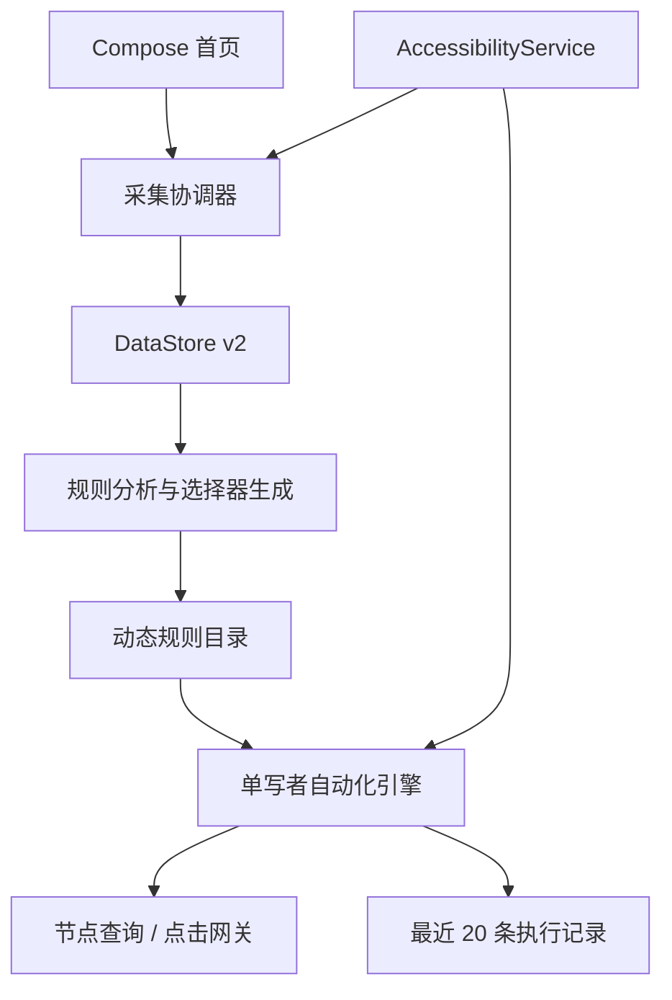

<div align="center">


# FlashSkip

**在手机本地采集规则的 Android 开屏广告关闭器**

通过系统无障碍服务识别关闭节点，在匹配唯一且满足安全约束时自动点击。

[](https://developer.android.com/about/versions/oreo)
[](https://kotlinlang.org/)
[](https://developer.android.com/compose)


[功能亮点](#功能亮点) · [使用方法](#使用方法) · [本地开发](#本地开发) · [隐私与安全](#隐私与安全) · [已知限制](#已知限制)

</div>

> [!IMPORTANT]
> FlashSkip 目前面向开发者本人侧载使用。项目不提供远程规则、规则市场、截图识别、OCR 或固定坐标点击。

## 为什么是 FlashSkip？

传统开屏广告规则通常需要开发者预先登记包名、分析页面结构，并随目标应用变化发布新版本。FlashSkip 将适配过程放到手机本地：用户亲自点击一次广告关闭按钮，应用只复制生成规则所需的有限无障碍语义，随后由同一套安全引擎执行。


## 功能亮点

| 能力 | 说明 |
| --- | --- |
| 通用规则采集 | 无需预先登记应用，成功采集后按实际包名动态生成应用项 |
| 本机规则目录 | 不同关闭选择器累计为多条规则，相同选择器合并 Activity 和证据 |
| 一次采集可用 | 具备可靠强选择器的有效样本可直接生成 Ready 规则 |
| 独立应用开关 | 新规则默认关闭，必须由用户明确启用，不会采集后自动生效 |
| 安全自动点击 | 动作前复核包名、Activity、活动窗口和选择器唯一性 |
| 有界启动会话 | 仅在目标应用进入前台后的 10 秒内尝试执行 |
| 可解释记录 | 最多保存最近 20 条结果、执行方式、阶段耗时和规则 ID |
| 完全离线 | 无网络权限，规则与执行记录只保存在应用私有存储中 |

## 使用方法

### 1. 开启无障碍服务

1. 安装并打开 FlashSkip。
2. 点击首页的“前往系统设置”。
3. 在无障碍设置中开启“FlashSkip 开屏关闭服务”。
4. 返回 FlashSkip，确认首页显示“服务运行正常”。

### 2. 采集关闭规则

1. 点击“采集规则”，FlashSkip 会暂停自动点击并返回 Home。
2. 手动启动需要适配的应用。
3. 等待开屏广告出现，只点击一次关闭或跳过按钮。
4. 返回 FlashSkip，点击“采集完成”。
5. 在动态生成的应用项中检查规则卡，然后手动开启自动关闭开关。

> [!TIP]
> 采集会绑定离开 Home 后首个验证成功的应用。开始采集后请直接启动目标应用，不要先打开其他应用。

### 3. 验证规则

重新冷启动目标应用并观察最近执行记录：

- `已关闭`：规则匹配并完成了节点点击或中心手势。
- `已放弃`：页面变化、匹配歧义或遍历超限，FlashSkip 主动停止执行。
- `执行失败`：已进入动作阶段，但系统未接受或无法确认动作结果。

## 工作原理

FlashSkip 只注册一个 `AccessibilityService`。采集状态的优先级高于自动化状态，任何活动采集会话都会暂停全局自动点击。



自动执行遵循以下约束：

1. 只有已启用且存在 Ready 规则的应用可以启动执行会话。
2. 包名、经验证 Activity、活动应用窗口必须同时一致。
3. 每次动作都重新查询节点，不跨挂起保存节点或坐标。
4. 唯一节点优先执行 `ACTION_CLICK`；仅在节点不支持直接点击时尝试节点中心手势。
5. 匹配歧义、页面切换、遍历超限或超过 10 秒窗口时安全退出。
6. 同一次前台会话最多成功执行一次。

## 隐私与安全

FlashSkip 的采集数据仅包含生成本机规则所需的有限字段：

- 目标应用包名与应用名称
- 经 `PackageManager` 验证的 Activity
- 限长的 `resourceId`、`text`、`contentDescription`
- 节点可见性、可点击性和相对点击时序

明确不会保存或申请：

- 截图、OCR 数据或完整页面节点树
- 固定坐标或长期持有的 Android 节点对象
- 剪贴板、外部存储或网络访问
- `QUERY_ALL_PACKAGES` 权限

Debug 采集日志仅记录状态、计数和耗时，不读取或输出页面文本、描述及节点内容；Release 构建关闭采集调试日志。

## 本地开发

### 环境要求

- Android Studio
- Android SDK 36.1
- JDK 21（运行 Gradle 与 Robolectric；Java 源码兼容级别为 17）
- Android 8.0（API 26）或更高版本的设备/模拟器

项目已包含 Gradle Wrapper，核心版本如下：

| 组件 | 版本 |
| --- | --- |
| Android Gradle Plugin | 9.2.1 |
| Gradle | 9.4.1 |
| Kotlin | 2.3.21 |
| Compose BOM | 2026.06.00 |
| minSdk / targetSdk | 26 / 36 |

### 构建与安装

```bash
./gradlew :app:assembleDebug
adb install -r app/build/outputs/apk/debug/app-debug.apk
```

也可以直接使用 Android Studio 选择已连接设备并运行 `app` 配置。

### 检查命令

```bash
./gradlew :app:testDebugUnitTest
./gradlew :app:lintDebug
./gradlew :app:assembleRelease
```

本地测试位于 `app/src/test/`：JUnit 4 与协程虚拟时钟验证状态竞争、超时和执行安全；Robolectric 4.17 在 API 26、36 上验证 Android 存储、v2 编解码、服务配置、日志脱敏及手势回调适配。Robolectric 首次运行需要下载对应 Android 测试运行库。

每项修复应附带回归测试。真实目标应用的无障碍事件、厂商后台策略和实际手势效果仍需连接设备验收；本地测试通过不代表真机验收完成。

## 项目结构

```text
app/src/main/kotlin/com/zhenghuaizhi/flashskip/
├── application/   # 服务状态与规则采集协调
├── data/          # DataStore 与版本化本地数据
├── domain/        # 自动化引擎、领域模型和规则分析
├── platform/      # 无障碍、系统设置和包信息适配
└── ui/            # Compose 首页与主题
```

关键模块：

- `RuleCaptureCoordinator`：管理采集状态、超时、取消和样本提交。
- `RuleCandidateAnalyzer`：生成、排序、合并并校验本机规则。
- `CompositeRuleCatalog`：组合本机规则与可选内置规则。
- `AutomationEngine`：串行处理前台事件、查询、动作和执行记录。
- `FlashSkipAccessibilityService`：维护系统事件订阅和前台隐私边界。

## 已知限制

- WebView、自绘界面或不暴露可靠无障碍语义的广告可能无法适配。
- 规则不绑定目标应用版本；目标应用升级后需要重新验证规则是否仍然安全有效。
- Android 厂商对后台和无障碍服务的管理策略不同，服务持续性需要在实际设备上验证。
- FlashSkip 不会使用固定坐标或视觉识别兜底，因此安全失败可能多于激进点击工具。

## 反馈

发现问题时，请在 [GitHub Issues](https://github.com/Mr414Zheng/flash_skip_android/issues) 提交设备型号、Android 版本、复现步骤和脱敏后的错误日志。请勿上传完整页面节点树或包含个人信息的截图。
